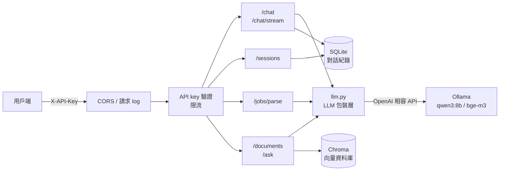

# FastAPI LLM 後端服務

用 FastAPI 打造的 LLM 後端服務，功能包含多輪對話（支援串流）、結構化資料擷取、RAG 文件問答，並具備 API key 驗證、限流、結構化 log 等正式環境的基本功能。LLM 透過 OpenAI 相容 API 呼叫，本機用 [Ollama](https://ollama.com) 免費執行，改環境變數就能換成 OpenAI 或其他供應商。

## 功能

- **多輪對話**：`/chat` 一次回傳，`/chat/stream` 逐字串流；對話紀錄存在資料庫，同一個 `session_id` 會帶入前文
- **結構化輸出**：`/jobs/parse` 從職缺描述擷取職稱、必備／加分技能、年資，回傳經過驗證的 JSON
- **RAG 文件問答**：`/documents` 上傳文字檔建立索引，`/ask` 根據文件內容回答並附上引用來源；文件裡沒有的資訊會回答不知道
- **正式環境基本功**：API key 驗證、依用戶端限流、LLM 逾時與重試、JSON 結構化 log、CORS

## 架構



RAG 流程：

- **上傳**：文件依 Markdown 章節與段落切塊 → 用 bge-m3 轉成向量 → 存進 Chroma
- **提問**：問題轉成向量 → 找出最相似的片段 → 組進 prompt → LLM 根據片段回答並標註 `[1]` 引用 → 只回傳實際被引用的片段

## 技術選型

| 項目 | 選擇 | 理由 |
|---|---|---|
| Web 框架 | FastAPI | 原生 async，等待 LLM 回應時不會卡住其他請求；自動產生 OpenAPI 文件；Pydantic 整合完整 |
| 資料驗證 | Pydantic v2 | 同一個 model 同時負責驗證請求、產生 API 文件、產生給 LLM 的 JSON schema |
| LLM SDK | OpenAI SDK（AsyncOpenAI） | OpenAI 相容 API 是業界通用格式，Ollama、vLLM 等都支援，換供應商只要改環境變數 |
| 本機模型 | Ollama：qwen3:8b、bge-m3 | 免費、資料不外流；qwen3 中文能力好，bge-m3 是多語言 embedding 模型 |
| 資料庫 | SQLAlchemy 2（async）+ SQLite | async 驅動（aiosqlite）不阻塞 event loop；之後換 PostgreSQL 只要改 `DATABASE_URL` |
| 向量資料庫 | Chroma | 可以嵌入式執行，不用另外架伺服器，適合中小規模 |
| 測試 | pytest + TestClient | LLM 全部 mock 掉，47 個測試不到 1 秒跑完 |
| 部署 | Docker | 非 root 執行、健康檢查、資料放在 volume |

## 快速開始

### 1. 準備 Ollama

安裝 [Ollama](https://ollama.com/download) 後下載模型：

```bash
ollama pull qwen3:8b
ollama pull bge-m3
```

### 2. 本機執行

```bash
python -m venv .venv
.venv\Scripts\activate          # macOS / Linux：source .venv/bin/activate
pip install -r requirements-dev.txt
cp .env.example .env            # 然後編輯 .env，把 API_KEYS 換成自己產生的隨機字串
fastapi dev app/main.py
```

產生 API key：

```bash
python -c "import secrets; print(secrets.token_urlsafe(32))"
```

打開 http://127.0.0.1:8000/docs ，按右上角 **Authorize** 填入 API key，就能直接試用所有 API。

### 3. 用 Docker 執行

```bash
docker build -t fastapi-llm .
docker run -d --name fastapi-llm -p 8000:8000 \
  --env-file .env \
  -e LLM_BASE_URL=http://host.docker.internal:11434/v1 \
  -v fastapi-llm-data:/data \
  fastapi-llm
```

- 容器裡的 `localhost` 指的是容器自己，所以要用 `host.docker.internal` 連到主機上的 Ollama
- 對話紀錄和向量資料存在 `fastapi-llm-data` volume，容器刪掉重建也不會遺失
- Linux 需要再加 `--add-host=host.docker.internal:host-gateway`，並讓 Ollama 監聽 `0.0.0.0`

## API

除了 `/health`，所有 API 都要在 header 帶 `X-API-Key`。

| 方法 | 路徑 | 說明 |
|---|---|---|
| GET | `/health` | 健康檢查，不需要 API key |
| POST | `/chat` | 對話，一次回傳完整回答。不帶 `session_id` 就開新對話 |
| POST | `/chat/stream` | 對話，逐字串流回傳；`session_id` 放在 response header `X-Session-Id` |
| GET | `/sessions/{session_id}/messages` | 查詢對話紀錄 |
| POST | `/jobs/parse` | 從職缺描述擷取結構化資料 |
| POST | `/documents` | 上傳 UTF-8 文字檔（.txt、.md，1 MB 以內）建立索引 |
| POST | `/ask` | 根據已上傳的文件回答問題，附上引用來源 |

範例：

```bash
# 開始新對話
curl -X POST http://127.0.0.1:8000/chat \
  -H "X-API-Key: $API_KEY" -H "Content-Type: application/json" \
  -d '{"message": "我叫小明，正在學 FastAPI"}'

# 串流（-N 關掉緩衝才看得到逐字輸出）
curl -N -X POST http://127.0.0.1:8000/chat/stream \
  -H "X-API-Key: $API_KEY" -H "Content-Type: application/json" \
  -d '{"message": "介紹一下台中"}'

# 上傳範例文件並提問
curl -X POST http://127.0.0.1:8000/documents -H "X-API-Key: $API_KEY" \
  -F "file=@samples/company_handbook.md"
curl -X POST http://127.0.0.1:8000/ask \
  -H "X-API-Key: $API_KEY" -H "Content-Type: application/json" \
  -d '{"question": "每週可以遠端工作幾天？"}'
```

錯誤狀態碼：

| 狀態碼 | 意思 |
|---|---|
| 401 | 沒帶或帶錯 API key |
| 404 | `session_id` 不存在 |
| 413 | 上傳檔案超過 1 MB |
| 422 | 請求格式不對（例如訊息是空字串） |
| 429 | 請求太頻繁，`Retry-After` header 告訴你幾秒後可以再試 |
| 502 | LLM 呼叫失敗，或 LLM 連續回傳格式錯誤的資料 |

## 環境變數

完整說明見 [.env.example](.env.example)。

| 變數 | 說明 | 預設值 |
|---|---|---|
| `LLM_MODEL` | 對話用的模型 | 必填 |
| `EMBEDDING_MODEL` | RAG 用的 embedding 模型 | 必填 |
| `API_KEYS` | 允許的 API key，逗號分隔可設多把 | 必填 |
| `LLM_BASE_URL` | OpenAI 相容 API 的位址 | `http://localhost:11434/v1` |
| `LLM_API_KEY` | LLM 服務的 key（Ollama 隨便填） | `ollama` |
| `LLM_REASONING_EFFORT` | 設 `none` 可關掉 qwen3 的思考模式 | 不傳 |
| `LLM_TIMEOUT` / `LLM_MAX_RETRIES` | LLM 請求逾時秒數、重試次數 | `60` / `2` |
| `RATE_LIMIT_PER_MINUTE` | 每把 key 每分鐘最多幾個請求 | `20` |
| `CORS_ORIGINS` | 允許呼叫的前端網域，逗號分隔 | `http://localhost:5173` |
| `DATABASE_URL` | 資料庫連線字串 | `sqlite+aiosqlite:///./app.db` |
| `CHROMA_PATH` | Chroma 資料目錄 | `./chroma_data` |

## 測試

```bash
pytest
```

- 所有測試都不會真的呼叫 LLM：`conftest.py` 用 autouse fixture 把 LLM 換成假的，並把 `LLM_BASE_URL` 指向不存在的位址當作第二道保險
- 每次測試都用暫存目錄裡全新的資料庫，不會動到開發用的資料
- 涵蓋：多輪對話、串流（含途中失敗）、結構化輸出重試、切塊邏輯、RAG 引用、API key 驗證、限流滑動視窗、CORS

## 設計重點

- **LLM 包裝在 `llm.py`**：router 只認得自訂的 `LLMError`，不知道底層用哪個 SDK。換供應商只要改這一個檔案，測試也只要 mock 這一層
- **串流的錯誤處理**：先連上 LLM 再回傳 `StreamingResponse`，連不上時還來得及回 502；串流一開始，狀態碼 200 就已經送出，途中失敗只能記 log 並在內容最後標示錯誤
- **寫入時機**：LLM 成功回答後，才把一問一答放在同一個 transaction 寫入，不會只存到問題；等 LLM 回應的期間也不佔用 SQLite 的寫入權（SQLite 同時只允許一個人寫）
- **LLM 輸出不可信**：結構化輸出有兩道防線，生成時用 JSON schema 限制，收到後再用 Pydantic 驗證；驗證失敗就把錯誤原因回饋給模型重試一次
- **RAG 不亂編**：依文件結構切塊，讓標題和內容留在同一塊；prompt 限定只能用提供的片段；找不到答案就說不知道；只回傳實際被引用的片段
- **安全**：API key 用 `secrets.compare_digest` 比對，避免 timing attack；log 和限流用 key 雜湊的前 8 碼當代號，log 不記 header、query string 和完整錯誤訊息
- **全程 async**：資料庫用 async 驅動；Chroma 的同步 API 用 `asyncio.to_thread` 丟到另一個 thread 執行，避免卡住 event loop
- **可觀察性**：每次 LLM 呼叫都記錄耗時和 token 用量，串流另外記錄首字延遲（TTFT）

## 已知限制與可改進的地方

- 限流資料存在記憶體，只適用單一 process；多個 worker 或多台機器要改用 Redis
- 資料表用 `create_all` 建立，正式環境應該改用 Alembic 管理 migration
- 高併發寫入時，SQLite 應該換成 PostgreSQL（改 `DATABASE_URL`，並安裝 asyncpg）
- 驗證失敗的請求沒有被限流計次；正式環境可以依 IP 限制驗證失敗的次數
- 換 embedding 模型後，要刪掉 `chroma_data/` 重新上傳文件（不同模型的向量不能混用）
- RAG 可以再加相似度門檻：片段都不夠相似時直接回答不知道，連 LLM 都不用呼叫

## 專案結構

```
├── app/
│   ├── main.py            # 建立 app、middleware、CORS、掛載 router
│   ├── config.py          # 用 pydantic-settings 讀取環境變數
│   ├── schemas.py         # Pydantic request / response models
│   ├── llm.py             # LLM 包裝層：對話、串流、embedding、逾時重試、log
│   ├── db.py              # 資料庫連線與 session（Depends 注入）
│   ├── models.py          # SQLAlchemy ORM models
│   ├── rag.py             # 切塊與 Chroma 向量資料庫操作
│   ├── security.py        # API key 驗證與限流
│   ├── logs.py            # JSON 結構化 log
│   └── routers/           # chat、sessions、jobs、rag 各自的路由
├── tests/                 # pytest 測試（LLM 全部 mock）
├── samples/               # RAG 範例文件
├── Dockerfile
├── requirements.txt       # 執行需要的套件
└── requirements-dev.txt   # 加上測試需要的套件
```
